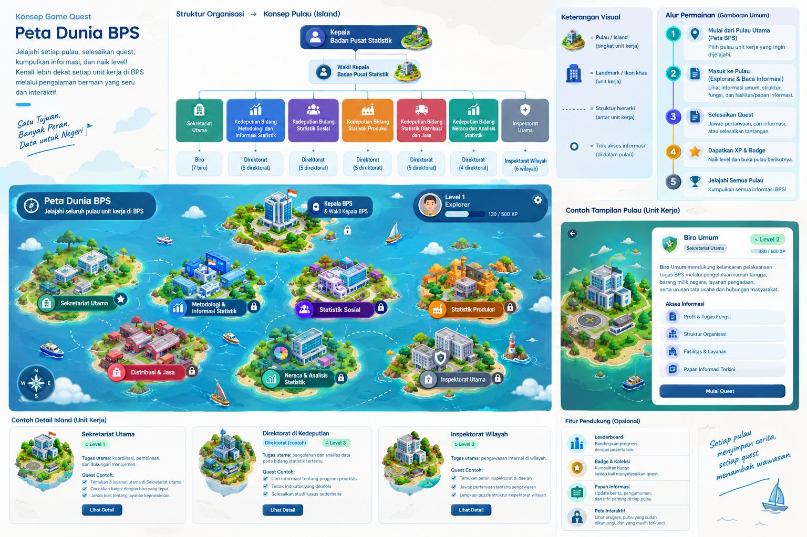

# BPS Quest — Peta Dunia BPS

Prototipe interaktif gamifikasi internal Badan Pusat Statistik (BPS) Republik Indonesia. Proyek ini memvisualisasikan unit-unit kerja BPS dalam bentuk pulau-pulau interaktif, kantor biro interaktif dengan avatar yang dapat digerakkan, serta papan informasi dan quest peran pegawai.



---

## 🚀 Fitur Utama

- **Peta Dunia BPS (`#/world`)**: Visualisasi 8 pulau unit kerja (Sekretariat Utama, Kedeputian, dan Pimpinan).
- **Eksplorasi Pulau & Biro (`#/island`)**: Peta pulau Sekretariat Utama dengan 7 biro kerja interaktif.
- **Denah Lantai Kantor Interaktif (`#/office`)**: 
  - Avatar interaktif dengan kontrol keyboard (WASD / Panah) dan D-Pad layar sentuh.
  - Deteksi tabrakan dinding (*sliding collision*) dan scaling otomatis resolusi tinggi.
  - Balon interaksi *"Tekan E"* saat mendekati objek.
- **Papan Informasi & Quest**:
  - Modal informasi biro (Profil, Tugas Fungsi, Struktur Organisasi).
  - Sistem quest peran pegawai dengan simulasi eligibilitas unit kerja (*role-based quest availability*).
  - Integrasi state reaktif dan persistensi pilihan via `localStorage`.

---

## 📂 Struktur Proyek

```text
bps-quest/
├── Prototype_Design.jpeg     # Desain acuan prototipe
├── peta-dunia-bps/           # Aplikasi web prototipe interaktif (100% self-contained)
│   ├── index.html            # Entry point aplikasi (buka langsung di browser)
│   ├── README.md             # Panduan detail & skenario demo 6 langkah
│   ├── css/
│   │   └── style.css         # Styling, layout panggung kanvas, UI modal, & HUD
│   └── js/
│       ├── data.js           # Data unit kerja, pulau, biro, & daftar quest
│       ├── state.js          # Global AppState (Pub/Sub & localStorage)
│       ├── router.js         # Hash-based client router
│       ├── hud.js            # HUD, notifikasi toast, & bilah simulasi
│       ├── panel.js          # Modal papan informasi & drawer quest
│       └── screens/          # Render kanvas untuk masing-masing rute
│           ├── world.js      # Layar peta dunia
│           ├── island.js     # Layar pulau biro
│           └── office.js     # Layar denah kantor & fisika avatar
└── README.md
```

---

## 💻 Cara Menjalankan

1. Buka folder `peta-dunia-bps/`.
2. Klik ganda (**double-click**) file `index.html` atau buka melalui browser apa pun.
3. Tidak memerlukan `npm`, `node`, `build tools`, maupun web server lokal (100% offline & client-side).
4. Untuk panduan skenario demo lengkap, silakan lihat [README peta-dunia-bps](./peta-dunia-bps/README.md).

